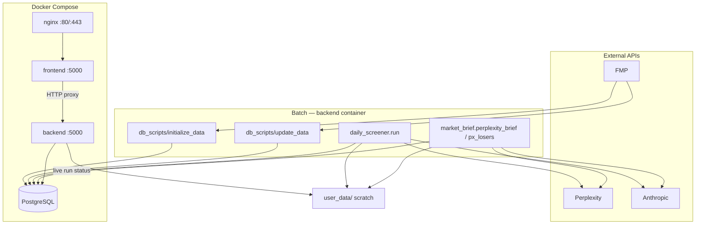

# Architecture

## Overview

Docker-compose stack: **Postgres** holds market data and pre-computed screener tables (schema `public`, rebuilt nightly) and user data + published pipeline outputs (schema `app`, see below); **db_scripts** ingest from FMP and build derivative tables; **backend** (Flask) serves JSON APIs over those tables; **frontend** (Flask + Jinja) proxies to backend and renders pages. **nginx** terminates HTTP/HTTPS and forwards to frontend.

LLM pipelines run inside the **backend** container as Python modules (not separate services). Each works in a scratch dir under `user_data/` and publishes its final output to the `app` schema:

| Module | Purpose | Published to |
|--------|---------|--------------|
| `daily_screener/` | Momentum + news + judge shortlist | `app.pipeline_runs` (`daily_screener`) |
| `market_brief/perplexity_brief.py` | Pre-market brief: DB universe + tape → Perplexity research → Sonnet (`/market-brief`) | `app.briefs` (`daily`/`perplexity`) |
| `market_brief/px_losers.py` | R1D losers brief: bottom `dr_1` per cap bucket → Perplexity ticker research → Sonnet | `app.briefs` (`losers`/`perplexity`) |
| `market_brief/narratives.py` | What moved markets, across published daily briefs (`/narratives`) | `app.pipeline_runs` (`narratives`) |
| `theme_discovery/` | Weekly screeners (mid/large/mega) → news per stock → themes (Opus, 2 passes + prior runs' themes) → probe per theme (`/theme-discovery`) | `app.pipeline_runs` (`theme_discovery`) |

## Runtime

| Service | Image / build | Host port | Role |
|---------|---------------|-----------|------|
| `db` | postgres:14 | 5432 | `stocks_db` |
| `backend` | `docker/backend.Dockerfile` | 5001→5000 | Flask API, batch scripts, LLM pipelines |
| `frontend` | `docker/frontend.Dockerfile` | 5002→5000 | Flask UI, thin proxy to backend |
| `price_alerts` | `docker/price_alerts.Dockerfile` | — | `price_alerts/watcher.py`: every `ALERT_POLL_SECONDS` (300) during 9:30–16:00 ET, batch yfinance 1m quotes for tickers in `app.chart_levels`; push to ntfy (`NTFY_TOPIC`) when `\|price - level\| / level <= ALERT_NEAR_PCT` (0.5). Once per level per day (`app.alert_fires`). Mounts `./price_alerts`, `./app_store`. |
| `nginx` | nginx:alpine | 80, 443 | Reverse proxy → frontend |

- Repo root is bind-mounted into `backend` (`/app`).
- `frontend` mounts `./frontend`, `./user_data`, `./logs`; it reads no user data itself (everything via backend).
- Env: `.env` → `DATABASE_URL`, `FMP_API_KEY`, `PERPLEXITY_API_KEY`, `ANTHROPIC_API_KEY`, SMTP, `NTFY_TOPIC`, `ALERT_CHART_BASE_URL` (ntfy click-through), optional `APP_BACKUP_REPO_DIR`.
- Ops: `./manage-env.sh prod|dev` (start/stop/init/update/backup). Run scripts via `docker-compose exec backend …`, not on host.

## Data layer

### Ingest (`db_scripts/initialize_data/`)

One-time or reset loads from **FMP** into base tables: `tickers`, `ohlc`, `company_profiles`, `ratios_ttm`, `earnings`, `analyst_estimates`, index prices/constituents, `shares_float`.

### Daily update (`db_scripts/update_data/`)

Typical daily chain (order matters):

1. `daily_price_update.py` — OHLC
2. `daily_indices_update.py` — index prices
3. `stock_metrics_update.py` — `stock_metrics` (dr_1/5/20/60/120, atr20, rsi, ti65, PE/PS, rev/eps growth, …)
4. `ticker_moving_averages_update.py` — `ticker_moving_averages` (dma/ema)
5. `volspike_gapper_update.py` — `stock_volspike_gapper`
6. `main_view_update.py` — `main_view` (metrics + volspike/gapper + tags)
7. Optional: `market_breadth_update.py`, `rs_screener_update.py`, `revenue_accel_update.py`

### Key tables (derivative / query-facing)

| Table | Built by | Consumed by |
|-------|----------|-------------|
| `stock_metrics` | `stock_metrics_update` | Scanner endpoints, `daily_screener` s1 |
| `stock_volspike_gapper` | `volspike_gapper_update` | Vol/gap screens, `daily_screener` s1 |
| `main_view` | `main_view_update` | Main view / technical screener UI |
| `ticker_moving_averages` | `ticker_moving_averages_update` | Charts (dma/ema), market breadth |
| `rs_screener`, `market_breadth` | respective updates | RS / breadth views |
| `revenue_acceleration` | `revenue_accel_update` (from `earnings`) | `/rev-accel` |

Schema + ORM: `backend/models.py`. Shared DB access pattern in `db_scripts/*` (SQLAlchemy, same `DATABASE_URL`).

## Backend API (`backend/app.py`)

Flask app on port 5000 inside container. Responsibilities:

- **Read** pre-computed rows with global filters (`apply_global_exclude_filters`, `apply_global_liquidity_filters`: avg_vol_10d, dollar_volume, price, industry exclusions).
- **Screener routes** — returns, gapper, volume, main view, technical criteria × market-cap bucket (Micro/Small/Mid/Large/Mega).
- **Stock detail** — profile, OHLC, earnings, news (FMP + Yahoo + Seeking Alpha, fetched live).
- **User state** — watchlist, dislikes, passes, trades, notes, chart notes/levels, themes, ETF groups: CRUD over `app.*` via `app_store.user`.
- **Pipeline control** — spawn subprocesses for `daily_screener.run`, `market_brief.perplexity_brief`, `market_brief.px_losers`, `market_brief.narratives`; serve published outputs from `app.briefs` / `app.pipeline_runs`, live run status from the scratch `status.json`.

Heavy computation belongs in **db_scripts**, not here. Backend adds HTTP filtering, formatting, and CRUD for user artifacts.

## Frontend (`frontend/app.py`)

Flask + Jinja templates under `frontend/templates/`, static under `frontend/static/`.

- Pages call `make_backend_request()` → `BACKEND_URL` (`http://backend:5000`).
- `/api/frontend/*` routes are BFF-style proxies (themes, watchlist, daily shortlist, market brief, screeners).
- **No business logic** for screening metrics; renders tables/charts from backend JSON.

Notable pages: `/main-view`, `/rev-accel`, `/top-performance`, `/volspike-gapper`, `/rs-screener`, `/stock/<ticker>`, `/abi-watchlist`, `/daily-shortlist`, `/daily-themes`, `/market-brief`, `/themes`.

## LLM pipelines

### Daily screener (`daily_screener/`)

Stages (JSON in/out under scratch `user_data/daily_screener/<YYYY-MM-DD>/`; top-level JSON published to `app.pipeline_runs` at the end):

1. **Universe** — DB: top dr_1/5/20 + volspike_gapper; veto active `app.dislikes` (skip expired temps)
2. **Momentum** — rule score (multi_screen, dr5_atr_norm, trend_alignment, …); threshold in `config.py`
3. **Themes** — merge `app.themes`, watchlist-derived themes (Claude), hot-market (Perplexity)
4. **News** — Perplexity per ticker
5. **Judge** — LLM verdict PICK/WATCH/SKIP + feedback from `app.screener_feedback`
6. **Audit** — `05_audit.json` (SoT for UI)

See `daily_screener/README.md` for flags and QA loop.

### Market brief (`market_brief/`)

Perplexity only (Benzinga/Massive retired 2026-10). `perplexity_brief.py`: DB screener universe (`screener_universe.py`: r1d, vol_spike_5d, main_view_ti65) + OHLC tape (`tape.py`) → Perplexity `sonar-pro` (broad probes + ticker batches → thread follow-ups → gap fills, `01_research/`) → fact ledger → Sonnet with `STEP4_SYSTEM_PROMPT` → coverage audit → revise → `02_brief.md`. `px_losers.py`: bottom `dr_1` per cap bucket (`losers_universe.py`) → ticker research + gap fills → Sonnet with `prompts/losers_synthesis.md`. Both publish to `app.briefs`; `status.json` + `run_costs.json` in the scratch dir drive the UI progress/cost panel while running. See `market_brief/README.md`.

## `app` schema (user data + published outputs)

Postgres schema `app`, created by `app_store/db.py` on first use. The nightly `init-zd` swap only replaces `public`, so `app` survives it; no FKs into `public`.

| Table | Contents |
|-------|----------|
| `watchlist`, `dislikes`, `passes`, `trades` | Ticker lists. Dislikes: `kind=permanent\|temporary` (`expires_at` = +30d), applied to all screener queries + daily_screener s1. Passes: `{scope: weekly\|daily, cycle}`; weekly = Sat-ET-iso, daily = session-iso. Trades: buy/short candidates (`T` badge). |
| `ticker_notes`, `chart_notes`, `chart_levels`, `general_notes` | Notes; `chart_levels` is also the price-alert list |
| `themes`, `etf_groups` | Curated theme tags; ETF groups for `/etfs` |
| `alert_fires` | Price-alert dedup `{"TICKER\|level": {date, price, fired_at}}`; pruned to today |
| `screener_feedback` | daily_screener judge calibration |
| `briefs` | PK `(date, kind daily\|losers, source perplexity\|benzinga)`: `brief_md`, `brief_json`, `run_costs`, `metadata`. Benzinga rows are history (2026-05-11 → 2026-10-15). |
| `pipeline_runs` | PK `(pipeline, run_key)`: `files` JSONB `{filename: json}` for `daily_screener`, `theme_discovery`, `narratives` |

Code: `app_store/user.py` (dict/list stores with the old JSON shapes), `app_store/artifacts.py` (briefs + runs). Hand-edit a store: `python -m app_store.cli export|import <store>`.

**Backup / restore.** `scripts/backup_app.sh` → `pg_dump -n app` to git-ignored `backups/app/app_<UTC>.sql.gz` (keeps 60; also commits `app.sql` to `APP_BACKUP_REPO_DIR` when set). Triggered by cron 22:30 UTC (`get_compute_instance_ready.sh`) and the nav 💾 Save button (`POST /api/backup`). `scripts/restore_app.sh [dump]` drops and reloads `app` in one transaction. Run both inside the backend container.

**`user_data/`** is now scratch only (pipeline working dirs: logs, `status.json`, intermediates); nothing reads it for content. One-off import of the old JSON files: `db_scripts/migrate_user_data_to_app.py` (idempotent, `--dry-run`, round-trip check).

## Where logic lives

| Layer | Owns |
|-------|------|
| **db_scripts** | Ingest, metric computation, table rebuilds, tags on `main_view` |
| **backend** | HTTP API, global query filters, user CRUD, subprocess orchestration |
| **daily_screener / market_brief / theme_discovery** | Multi-step LLM workflows; scratch files, published to `app` |
| **app_store** | `app` schema DDL + access (user stores, briefs, pipeline runs) |
| **frontend** | Routing, proxy, rendering |

**Default:** new screening fields or filters → compute in `db_scripts`, expose via backend route, render in frontend. Backend-only logic is acceptable for API-specific shaping; frontend logic only for presentation.

## Other paths

| Path | Notes |
|------|-------|
| `screening_agent/` | Legacy experiment; not used by production UI |
| `weekly_brief/` | Empty placeholder |
| `tests/` | pytest |
| `archive/` | Old compose variants |

## Related docs

- `frontend/COMPONENTS.md` — desktop/mobile UI file map (templates, CSS, JS)
- `README/README.md` — init/update command cheatsheets
- `README/ENDPOINTS.md` — API URL list
- `daily_screener/README.md`, `market_brief/README.md` — pipeline detail
